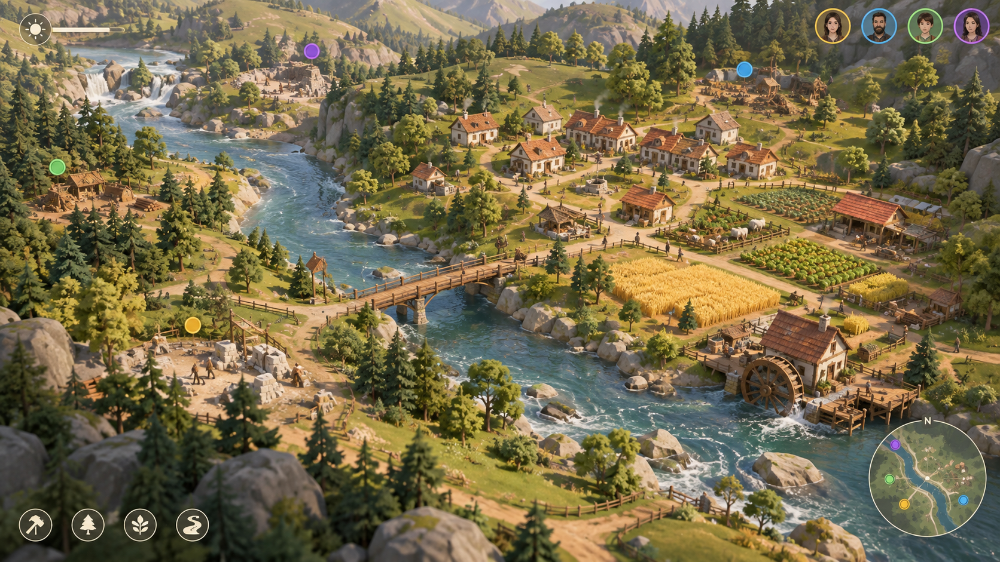

# 创世谷 Genesis Valley

PC 上帝视角模拟建造游戏（团结引擎 1.10.4 / 2022.3.62t16 · URP 14）。塑造一片微缩山谷——抬升山丘、引来河流、种下森林、召唤居民——然后看着村民们自己伐木、开田、捕鱼、盖房、架桥，把营地发展成一个有灯火的村庄。

> 上图是 AI 生成的**视觉目标参考图**，不是实机截图。

## 快速开始

1. 用团结引擎 1.10.4 打开 `GenesisValley/` 工程（第一次导入约 91 MB 的美术资源，需要几分钟）。
2. 导入完成后会弹出「检测到项目还没有完成配置」→ 点 **立即配置**；或者手动点菜单 **Genesis Valley › 一键配置 (Setup Everything)**。
3. 菜单 **Genesis Valley › 运行游戏 ▶**。
4. 打包：**Genesis Valley › 构建 Windows 版本** → `GenesisValley/Builds/Windows/GenesisValley.exe`。

详细步骤、命令行构建和常见问题见 [docs/SETUP.md](docs/SETUP.md)。

## 操作

| 操作 | 按键 |
|---|---|
| 平移 / 旋转 / 缩放镜头 | WASD 或 鼠标中键拖动 / Q E 或 右键拖动 / 滚轮 或 R F |
| 工具：观察 · 抬升 · 降低 · 平整 · 河流 · 森林 · 召唤 · 桥梁意向 | 1 – 8 |
| 笔刷大小 | [ ] |
| 撤销（按笔划） | 退格 |
| 暂停 / 1× / 2× / 4× | 空格 / Z / X / C |
| 湿润度叠加层 | Tab |
| 回到营地 | H |
| 快速存档 / 读档 | F5 / F9 |
| 拍照模式 / 隐藏界面 | P / F1 |

所有按键都可以在「设置 › 按键」里改。

## 目录

| 路径 | 说明 |
|---|---|
| `Genesis_Valley_V1_GDD.md` | 权威设计文档 |
| `GenesisValley/Assets/Game/` | 游戏代码、着色器、生成美术（图标/音乐/音效/特效贴图）与编辑器工具 |
| `GenesisValley/Assets/ThirdParty/` | 精选并预处理过的 CC0 / OFL 第三方素材（来源与许可见 docs/ASSET_LEDGER.md） |
| `docs/` | 安装配置、项目状态、素材台账 |
| `tools/` | 素材预处理与程序化生成脚本（Python） |

## 当前状态

见 [PROJECT_STATUS.md](PROJECT_STATUS.md)。
